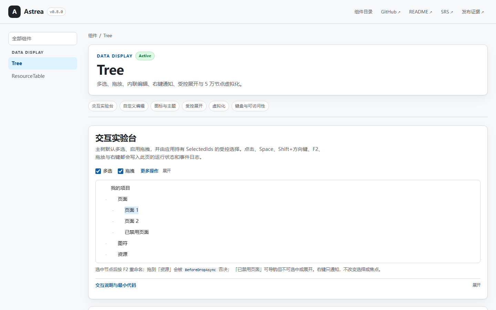

# Astrea

[English](README.en.md) | 简体中文

**Blazor UI components for .NET 6 — Tree and ResourceTable.** · 面向 .NET 6 Blazor 应用的可复用组件库，当前交付 Tree 与 ResourceTable。

**定位**：仍在 .NET 6 上维护 Blazor Server / WebAssembly 应用，需要键盘可操作、状态可控的树形编辑器与列驱动资源表格的团队。
**状态**：已发布 0.8.0（依据：GitHub Release v0.8.0 附 `Astrea.Components.0.8.0.nupkg`；nuget.org 同名包 0.8.0；`Astrea.Components.csproj` 的 `<Version>` 为 `0.8.0`）。0.x 预览期，小版本可能包含已在 CHANGELOG 记录的破坏性变更；Active 组件仅 Tree 与 ResourceTable，其余 9 个为 Deferred。

[](https://github.com/HestiaLab/Astrea/actions/workflows/ci.yml)
[](https://github.com/HestiaLab/Astrea/releases)
[](https://www.nuget.org/packages/Astrea.Components)
[](LICENSE)

[在线演示](https://hestialab.github.io/Astrea/) · [快速开始](#快速开始) · [SRS](docs/SRS.md) · [Roadmap](docs/Roadmap.md) · [更新日志](CHANGELOG.md) · [贡献指南](CONTRIBUTING.md)



Astrea 是面向 .NET 6 的 Blazor 组件库，当前版本只交付两个组件：Tree（树形编辑器）与 ResourceTable（列驱动资源表格），其余 9 个规划组件标记为 Deferred，不属于当前发布契约。
Tree 支持多选、三态拖放与应用侧否决、F2 内联编辑、右键通知、受控/非受控选择与展开，以及固定行高虚拟化（演示页可生成 5 万节点）。
组件按 WAI-ARIA Tree View 模式实现单一 Tab 停靠点与 `aria-activedescendant`；发布的验证证据记录 Tree 与 ResourceTable 容器的 axe 审计为 0 个 serious/critical 违规。

## 当前版本范围

| 组件 | 状态 | SRS |
|---|---|---|
| Tree | Active | §3.10 |
| ResourceTable | Active | §3.12 |
| Button、Alert、Divider、Input、Label、Modal、Progress、Select、Table | Deferred | 附录 B / [Roadmap](docs/Roadmap.md) |

## 演示站

Blazor WebAssembly 演示以 GitHub Pages 项目站点发布：<https://hestialab.github.io/Astrea/>。部署工作流会把 `<base href>` 改写为 `/Astrea/`，并把改写后的 `index.html` 复制为 `404.html`，因此直接访问链接或刷新时仍能进入 Blazor 路由。

应用内所有链接必须保持相对于 `<base>` 路径（例如 `components/tree`；目录首页使用空 `href`）。不要使用 `/components/tree` 这类根绝对路径，它会解析到项目站点之外。推送到 `main` 或 `dev` 会自动部署；也可以使用 `Deploy demo to GitHub Pages` 工作流的 `workflow_dispatch` 手动重新部署。

## Tree 功能

- **多选** — Ctrl 切换选中；Shift 范围选择可以跨同一 Tree 的根边界，拒绝禁用端点并跳过禁用中间节点。键盘：Space 切换焦点节点；Shift+方向键/Home/End 从键盘锚点扩展范围。
- **拖放** — `before` / `inside` / `after` 三种放置位置；支持应用侧否决；内置拒绝自引用、跨树、成环、过期操作与重复完成。
- **内联编辑** — F2 进入，Enter 提交，Esc 取消；支持 `BeforeRename` 否决。
- **右键菜单通知** — Tree 只通知（节点 + 位置）；菜单由应用渲染，且不改变选中或焦点。
- **ARIA 键盘导航** — 方向键 / Home / End / Space / Enter，单一 Tab 停靠点，`aria-activedescendant`。
- **受控或非受控** — `SelectedIds` / `ExpandedIds` 为 `null` 表示非受控，非 `null` 表示受控。
- **可选虚拟化** — 仅支持固定行高；`EnableVirtualization` 默认 `false`。
- **健壮性** — 禁用节点、空状态、焦点恢复；`DataSource` 按稳定 ID 替换后状态保留。

## 快速开始

> **包标识（0.8.0）：** NuGet 包 ID、程序集名称与静态资源基路径均为 `Astrea.Components`（旧名为 `Astrea`）。请更新 `PackageReference Include="Astrea.Components"`，并把 `_content/Astrea/` 链接改为 `_content/Astrea.Components/`；公共命名空间仍为 `Astrea.Components.*`。0.8.0 是新包标识下的第一个版本，组件行为未变。

包只提供 `net6.0` 资产，宿主项目需要面向 .NET 6。以下命令在宿主 Blazor 项目目录中执行；默认源为 nuget.org，可直接安装，GitHub Packages 是可选替代（见下文）。

1. 安装 NuGet 包（本地开发也可直接引用 `src/Astrea.Components/Astrea.Components.csproj`）：

```sh
dotnet add package Astrea.Components --version 0.8.0
```

2. 在 `_Imports.razor` 中添加命名空间：

```razor
@using Astrea.Components.Tree
```

3. 在 `wwwroot/index.html` 中引入样式表：

```html
<link href="_content/Astrea.Components/astrea-tree.css" rel="stylesheet" />
```

4. 最小示例：

```razor
<Tree DataSource="_roots" aria-label="Project files" />

@code {
    private readonly List<TreeNode> _roots = new()
    {
        new TreeNode("Root", isExpanded: true)
    };
}
```

### GitHub Packages

发布版本也会推送到本仓库的 GitHub Packages 源。GitHub Packages 即使对公开包也要求认证，因此从该源还原需要具有 `read:packages` 权限的个人访问令牌。把源加入 `nuget.config`：

```xml
<configuration>
  <packageSources>
    <add key="astrea-github" value="https://nuget.pkg.github.com/HestiaLab/index.json" />
  </packageSources>
  <packageSourceCredentials>
    <astrea-github>
      <add key="Username" value="YOUR_GITHUB_USERNAME" />
      <add key="ClearTextPassword" value="YOUR_GITHUB_TOKEN" />
    </astrea-github>
  </packageSourceCredentials>
</configuration>
```

## Tree 参数

| 参数 | 类型 | 默认值 | 说明 |
|---|---|---|---|
| `DataSource` | `IReadOnlyList<TreeNode>?` | 必填 | 根节点 |
| `SelectionMode` | `TreeSelectionMode` | `Single` | `Single` 或 `Multiple` |
| `SelectedIds` | `IReadOnlyCollection<string>?` | `null` | `null` = 非受控；非 `null` 为受控选择的权威来源 |
| `SelectedIdsChanged` | `EventCallback<IReadOnlyCollection<string>>` | — | 提议下一次受控选择；在应用提供新集合前不会提交 |
| `ExpandedIds` | `IReadOnlyCollection<string>?` | `null` | `null` = 非受控；非 `null` 为受控展开的权威来源 |
| `ExpandedIdsChanged` | `EventCallback<IReadOnlyCollection<string>>` | — | 提议下一次受控展开；在应用提供新集合前不会提交 |
| `AllowDrag` | `bool` | `false` | 启用拖放 |
| `EnableVirtualization` | `bool` | `false` | 固定行高虚拟化 |
| `AutoDetectStructureChanges` | `bool` | `true` | 每次渲染检测原地结构变化；大树可关闭，并在原地修改后调用 `RefreshAsync` |
| `ItemSize` | `float` | `32f` | 行高（px）；虚拟化时必须大于 0 |
| `UseInternalKeyboard` | `bool` | `true` | 内置 ARIA 键盘导航 |
| `ShowLink` | `bool` | `true` | 在缩进区域绘制父子连接线 |
| `BeforeExpandAsync` | `Func<TreeNode, ValueTask<bool>>?` | `null` | 异步展开否决；用它替代 `BeforeExpand` |
| `BeforeCollapseAsync` | `Func<TreeNode, ValueTask<bool>>?` | `null` | 异步折叠否决；用它替代 `BeforeCollapse` |
| `BeforeDropAsync` | `Func<TreeDropEventArgs, ValueTask<bool>>?` | `null` | 异步拖放否决；用它替代 `BeforeDrop` |
| `BeforeRenameAsync` | `Func<TreeNode, string, ValueTask<bool>>?` | `null` | 异步重命名否决；用它替代 `BeforeRename` |
| `BeforeEditNameAsync` | `Func<TreeNode, ValueTask<bool>>?` | `null` | 异步进入编辑否决；用它替代 `BeforeEditName` |
| `Indent` | `int` | `20` | 每级缩进（px） |
| `OnlyHighlightText` | `bool` | `true` | 选中时只高亮文本 |
| `LoadingText` | `string` | `"Loading items..."` | 虚拟化加载占位文本 |
| `EditLabelFormat` | `string` | `"Edit {0}"` | 默认编辑输入框的无障碍名称；`{0}` 为节点文本 |
| `RenameRejectedText` | `string` | `"Rename rejected"` | 重命名被否决时的回退校验消息 |
| `NodeTemplate` | `RenderFragment<TreeNode>?` | `null` | 自定义节点内容（与虚拟化不兼容） |
| `IconTemplate` | `RenderFragment<TreeIconContext>?` | `null` | 自定义节点图标 |
| `EditTemplate` | `RenderFragment<TreeEditContext>?` | `null` | 自定义编辑 UI（与虚拟化不兼容） |
| `BeforeExpand` | `Func<TreeNode, bool>?` | `null` | 否决展开；`false` 阻止 |
| `BeforeCollapse` | `Func<TreeNode, bool>?` | `null` | 否决折叠；`false` 阻止 |
| `BeforeDrop` | `Func<TreeDropEventArgs, bool>?` | `null` | 否决拖放；`false` 阻止 |
| `BeforeRename` | `Func<TreeNode, string, bool>?` | `null` | 否决重命名；`false` 阻止 |
| `BeforeEditName` | `Func<TreeNode, bool>?` | `null` | 否决进入编辑模式；`false` 阻止 |
| `AdditionalAttributes` | `IReadOnlyDictionary<string, object>?` | — | 合并到 `role="tree"` 容器上的额外 HTML 属性 |

### 受控状态契约

- `SelectedIds="null"` 与 `ExpandedIds="null"` 表示非受控模式。Tree 持有该状态，并报告真实的用户变更。
- 非 `null` 集合（包括空集合）表示受控模式。它始终是显示的权威来源。
- 在受控模式下，一次用户操作最多提议一个下一集合。在应用提供该集合之前，显示不会改变；即使未附加变更回调，或应用拒绝/延迟该提议，也是如此。
- 替换受控集合属于应用侧更新，不会再触发一次用户变更事件。
- `DataSource="null"` 与空数据源都会保留一个空但可访问的 Tree 容器。Tree 不会伪造节点。
- 默认检测原地结构变化。大树可设置 `AutoDetectStructureChanges="false"`，并在修改后调用 `RefreshAsync()`。直接原地修改 `TreeNode.IsExpanded` 也需要 `RefreshAsync()`；优先使用 `ExpandedIds` 或 `SetExpandedAsync`。
- 本次重构不引入隐藏的合成根模式。应直接把需要出现在第一可见层级的节点作为 `DataSource` 根提供。

## Tree 事件

| 事件 | EventArgs | 说明 |
|---|---|---|
| `OnSelectionChanged` | `TreeSelectionChangedEventArgs` | 选中实际变化时触发一次（`OldSelectedIds`、`SelectedIds`） |
| `OnExpandedChanged` | `TreeExpandedChangedEventArgs` | 展开状态变化时触发（`Node`、`IsExpanded`） |
| `OnNodeClicked` | `TreeNodeEventArgs` | 点击未禁用节点时触发 |
| `OnNodeInvoked` | `TreeNodeEventArgs` | 双击激活时触发 |
| `OnContextMenu` | `TreeContextMenuEventArgs` | 右键通知（`Node`、`MouseArgs`）；Tree 不渲染菜单 |
| `OnDrop` | `TreeDropEventArgs` | 协议、结构与守卫检查全部通过后触发一次（`SourceNodes`、`TargetNode`、`Relation`） |
| `OnEditCommitted` | `TreeEditEventArgs` | 编辑提交时触发（`Node`、`Value`） |
| `OnEditCancelled` | `TreeNodeEventArgs` | 编辑取消时触发 |
| `OnEditRejected` | `TreeEditRejectedEventArgs` | 重命名被否决时触发（`Node`、`Value`、`Reason`） |
| `OnKeyDown` | `KeyboardEventArgs` | 内置键盘导航之前触发 |

## 公共方法

| 成员 | 说明 |
|---|---|
| `View` | 只读 Tree 查询视图；`Flatten`/`FlattenVisible` 返回基于内部缓存的真实只读视图 |
| `SelectAsync`、`FocusAsync`、`BeginEditAsync`、`RefreshAsync` | 以稳定节点 ID 标识、带校验的 Tree 命令 |

所有改变状态的公共路径都经过同一套所有权、禁用节点、选择模式、修订版本与会话校验。查询对象不暴露选择、展开、编辑或结构修改方法。

## 核心类型

### TreeNode

```csharp
var node = new TreeNode("Label", icon: null, bindData: null, id: "stable-id");
node.Add(new TreeNode("Child"));
```

- **标识**：`Id`（应用提供的 ID 可在重建后保留，否则自动分配）、`Text`（拒绝 null/空串）、`BindData`、`PlaceHolder`。
- **结构**：`Parent`、`Children`、`Index`、`Level`、`IsRoot`、`HasChildren`、`IsLeaf`、`Root`、`Count`、`Siblings()`、`GetPathToRoot()`、`IsDescendantOf(node)`、`IsAncestorOf(node)`。
- **结构变更**：`Add`、`Remove`、`Insert`、`AddChildren`、`InsertChildren`、`RemoveChildren`。成环挂载（挂到自身，或把祖先挂到其后代之下）会抛异常。
- **样式**：`SetCssClass(string)`、`CssClassResolver`（动态片段）、`CssClass`。
- **图标**：`Icon`、`UnFoldIcon`、`ExpandedIcon`、`CollapsedIcon`、`ExpandIcon`、`FoldIcon`、`IsExpandIconDisable`、`IsFoldIconDisable`、`IsExpandDisable`。
- **视图状态**：`IsSelected` 与 `IsFocused` 是派生查询；`IsEditing` 只有内部 setter。`IsExpanded` 对应用只读：初始展开状态用构造函数参数 `isExpanded` 设置，之后使用 `ExpandedIds` 或 `SetExpandedAsync`。`IsDisabled` 仍是应用数据。
- **旧节点门面方法**：只读查询辅助方法仍可用；改变状态的辅助方法收归到带校验的 Tree 命令边界内部。

### Tree 查询视图（通过 `Tree.View`）

- **查询**：选中的 ID、焦点 ID/节点、修订版本、稳定 ID 查找，以及扁平化的可见节点。
- **命令**：选择、焦点、展开、编辑与刷新都通过 Tree 命令门面，而不是这个查询视图。

### 枚举与上下文

- `TreeSelectionMode`：`Single`、`Multiple`。
- `TreeDropRelation`：`Before`、`Inside`、`After`。
- `TreeEditContext`（用于 `EditTemplate`）：`Node`、`Value`、`SetValue(value)`、`CommitAsync()`、`CancelAsync()`、`ValidationMessage`。
- `TreeIconContext`（用于 `IconTemplate`）：`Node`、`IsExpanded`、`HasChildren`、`IsDisabled`。

每个编辑上下文只属于一个编辑会话。一旦另一个编辑开始、其节点被替换或移除，或组件被释放，旧上下文的调用就不能提交或取消当前编辑。

### API 迁移契约

| 旧接口 | 冻结方向 |
|---|---|
| `Tree.Controller`、可写的 `Controller.Selection`，或可变的选中/展开集合 | 查询使用 `Tree.View`；`TreeController` 与 `TreeState` 成为内部实现细节 |
| `TreeController` 上的状态变更方法 | 内部；使用以稳定节点 ID 标识、带校验的异步 Tree 命令 |
| `TreeNode` 门面上的状态变更方法 | 内部；使用对应的带校验 Tree 命令 |
| 可写的 `TreeNode.IsSelected`、`IsFocused` 或 `IsEditing` | 不再作为权威状态；`IsEditing` 只有内部 setter |
| 作为第二状态源的 `TreeNode.IsExpanded` | 对应用只读；初始状态用构造函数参数 `isExpanded`，之后使用 `ExpandedIds`/`SetExpandedAsync` |
| 同步否决委托 | 在 Tree 上配置 `Before*` 或 `Before*Async`，不要同时配置；控制器级守卫已在 0.7.0 移除 |
| 元组形式的事件载荷 | 具名 EventArgs 类型 |

应用决策可以异步完成。Tree 在等待期间不提交，在应用结果前重新校验节点与操作；结果过期时保持状态不变，并且不会静默吞掉决策错误。一次拖放操作在接受、拒绝、取消、禁用或释放后最多被消费一次。

自 0.7.0 起，`TreeController`、`TreeState`、`DragProtocol`、`TreeKeyboardNavigation` 与 `TreeDropValidation` 均为内部类型。应用通过 `Tree`、`TreeView`、`TreeNode`、事件与上下文类型交互。

## 示例

### 多选

```razor
<Tree DataSource="_roots" SelectionMode="TreeSelectionMode.Multiple"
      OnSelectionChanged="OnSelectionChanged" />

@code {
    private void OnSelectionChanged(TreeSelectionChangedEventArgs args)
        => Console.WriteLine($"selection: {args.SelectedIds.Count} node(s)");
}
```

### 带否决的拖放

```razor
<Tree DataSource="_roots" AllowDrag="true"
      BeforeDrop="BeforeDrop" OnDrop="OnDrop" />

@code {
    private bool BeforeDrop(TreeDropEventArgs args)
        => args.TargetNode.Text != "Resources"; // forbid dropping into "Resources"

    private void OnDrop(TreeDropEventArgs args)
    {
        // args.SourceNodes / args.TargetNode / args.Relation (Before | Inside | After)
        // The app decides the final structure and updates its data source.
    }
}
```

### 内联编辑

```razor
<Tree DataSource="_roots" BeforeRename="BeforeRename"
      OnEditCommitted="OnEditCommitted" OnKeyDown="OnKeyDown" @ref="_tree" />

@code {
    private Tree? _tree;

    private bool BeforeRename(TreeNode node, string value) => !string.IsNullOrWhiteSpace(value);

    private async Task OnKeyDown(KeyboardEventArgs args)
    {
        if (args.Key == "F2" && _tree?.View?.FocusedId is { } nodeId)
            await _tree.BeginEditAsync(nodeId);
    }

    private void OnEditCommitted(TreeEditEventArgs args) => args.Node.Text = args.Value;
}
```

### 右键菜单通知

```razor
<Tree DataSource="_roots" OnContextMenu="OnContextMenu" />

@code {
    private void OnContextMenu(TreeContextMenuEventArgs args)
    {
        // args.Node / args.MouseArgs — the tree only notifies; render your own menu.
    }
}
```

### 固定行高虚拟化

```razor
<div style="height: 320px;">
    <Tree DataSource="_largeDataSource" EnableVirtualization="true" ItemSize="32" />
</div>
```

虚拟化需要一个有界高度的滚动容器和固定行高。`ItemSize` 必须与节点高度一致，并且 `NodeTemplate` / `EditTemplate` 不能与虚拟化同时使用。

### 自定义图标与编辑模板

```razor
<Tree DataSource="_roots">
    <IconTemplate Context="icon">
        <span class="@(icon.IsExpanded ? "folder-open" : "folder")"></span>
    </IconTemplate>
    <EditTemplate Context="edit">
        <input value="@edit.Value"
               @oninput="e => edit.SetValue(e.Value?.ToString() ?? "")"
               @onkeydown="e => OnEditKey(e, edit)" />
    </EditTemplate>
</Tree>

@code {
    private Task OnEditKey(KeyboardEventArgs e, TreeEditContext edit)
    {
        if (e.Key == "Enter")
        {
            return edit.CommitAsync();
        }

        if (e.Key == "Escape")
        {
            return edit.CancelAsync();
        }

        return Task.CompletedTask;
    }
}
```

## 无障碍（WAI-ARIA）

Tree 遵循 [WAI-ARIA Tree View 模式](https://www.w3.org/WAI/ARIA/apg/patterns/treeview/)：容器上有单一 Tab 停靠点（`role="tree"` 与 `tabindex="0"`），`role="treeitem"` 节点不可聚焦，焦点通过 `aria-activedescendant` 跟踪。点击节点会把 DOM 焦点移到容器。组件输出 `aria-level`、`aria-selected`、`aria-expanded` 与 `aria-disabled`。禁用节点可导航，但不可选中、展开或激活。

## ResourceTable

ResourceTable 渲染列驱动的表头与应用提供的表体。它支持指针与键盘调整列宽、工具栏操作、撤销/重做按钮，以及空列集合。

### 快速开始

```razor
@using Astrea.Components.ResourceTable
```

```html
<link href="_content/Astrea.Components/astrea-resource-table.css" rel="stylesheet" />
```

```razor
<div style="height: 360px;">
    <ResourceTable Columns="_columns"
                   TableBody="RenderRows"
                   ResizableColumns="true"
                   OnColumnResized="HandleColumnResized" />
</div>

@code {
    private readonly List<TableColumn> _columns = new()
    {
        new("ID") { Key = "id", Width = "60px", MinWidth = 40 },
        new("Name") { Key = "name", Width = "160px", MinWidth = 60 },
        new("Type") { Key = "type" }
    };

    private RenderFragment RenderRows => builder =>
    {
        builder.OpenElement(0, "tr");
        builder.OpenElement(1, "td");
        builder.AddContent(2, "sample");
        builder.CloseElement();
        builder.CloseElement();
    };

    private void HandleColumnResized(ColumnResizedEventArgs args)
    {
        // args.ColumnIndex / args.ColumnKey / args.NewWidth
    }
}
```

### ResourceTable 参数

| 参数 | 类型 | 默认值 | 说明 |
|---|---|---|---|
| `Columns` | `IEnumerable<TableColumn>` | 必填 | 列定义；空集合不渲染表头单元格 |
| `TableBody` | `RenderFragment?` | 必填 | 渲染在 `tbody` 内的表体标记 |
| `ToolBar` | `RenderFragment?` | `null` | 额外工具栏内容 |
| `ShowButton` | `bool` | `true` | 渲染新增/删除/移动按钮 |
| `ShowRedoButton` | `bool` | `false` | 渲染撤销/重做按钮 |
| `ContainerCss` | `string?` | `null` | 根容器的额外 CSS 类 |
| `ResizableColumns` | `bool` | `true` | 渲染调整手柄并启用调整模块 |
| `CanUndo` / `CanRedo` | `bool` | `false` | 撤销/重做按钮的禁用状态 |
| `OnAddClicked` / `OnRemoveClicked` / `OnMoveUpClicked` / `OnMoveDownClicked` | `EventCallback` | — | 工具栏操作通知 |
| `OnUndoClicked` / `OnRedoClicked` | `EventCallback` | — | 撤销/重做通知 |
| `OnKeyDown` | `EventCallback<KeyboardEventArgs>` | — | 容器键盘事件转发 |
| `OnColumnResized` | `EventCallback<ColumnResizedEventArgs>` | — | 指针或键盘调整列宽后触发 |
| `AddButtonLabel` / `RemoveButtonLabel` / `MoveUpButtonLabel` / `MoveDownButtonLabel` / `UndoButtonLabel` / `RedoButtonLabel` | `string` | `Add` / `Remove` / `Move Up` / `Move Down` / `Undo` / `Redo` | 工具栏按钮的无障碍名称/提示 |
| `ResizeHandleLabelFormat` | `string` | `"Resize column {0}"` | 调整手柄的无障碍名称；`{0}` 为列标题 |
| `IconAdd` / `IconRemove` / `IconMoveUp` / `IconMoveDown` / `IconUndo` / `IconRedo` | `RenderFragment?` | `null` | 覆盖内置内联 SVG 图标 |
| `AdditionalAttributes` | `IReadOnlyDictionary<string, object>?` | — | 额外 HTML 属性；应用的类会追加到组件类之后 |

`TableColumn` 声明 `Title`、`Width`、`Key`、`MinWidth` 与 `Resizable`（最后一列永远没有调整手柄）。

### 键盘与无障碍

- 每个调整手柄都是可聚焦的 `role="separator"`，带 `aria-orientation="vertical"` 与无障碍名称。
- ArrowLeft/ArrowRight 以 10 px 调整焦点边界，遵守 `MinWidth`，并保持两列总宽度不变。
- 调整列宽的 keydown 事件不会停止传播；应用仍可通过 `OnKeyDown` 收到它们。
- `ResizableColumns="false"` 会移除所有手柄并释放调整监听器。列定义或最小宽度变化时模块会重新初始化。

### 主题变量

组件公开有文档的 `--ast-*` 变量。可在组件根或任意祖先上覆盖。

Tree：

| 变量 | 默认值 | 用途 |
|---|---|---|
| `--ast-tree-font-size` | `14px` | 节点文本大小 |
| `--ast-tree-line-height` | `1.6` | 节点行高 |
| `--ast-tree-color-text` | `#1f2328` | 节点文本颜色 |
| `--ast-tree-node-height` | `32px` | 节点最小高度 |
| `--ast-tree-color-hover` | `rgba(0,0,0,0.05)` | 悬停背景 |
| `--ast-tree-color-focus` | `rgba(24,144,255,0.15)` | 焦点背景 |
| `--ast-tree-color-active` | `rgba(24,144,255,0.25)` | 选中背景 |
| `--ast-tree-color-border` | `#d0d7de` | 编辑输入框边框 |
| `--ast-tree-icon-size` | `16px` | 图标框大小 |
| `--ast-tree-control-indent` | `20px` | 展开控件槽宽度 |
| `--ast-tree-font-weight-bold` | `600` | 粗体节点文本 |

ResourceTable：

| 变量 | 默认值 | 用途 |
|---|---|---|
| `--ast-rt-font-family` | `sans-serif` | 表格字体 |
| `--ast-rt-font-size` | `14px` | 表格字号 |
| `--ast-rt-color-text` | `#333` | 文本颜色 |
| `--ast-rt-color-bg` | `#fff` | 表面/按钮背景 |
| `--ast-rt-color-header-bg` | `#f5f5f5` | 表头背景 |
| `--ast-rt-color-border` | `#ddd` | 单元格/按钮边框 |
| `--ast-rt-color-border-strong` | `#989ca4` | 滚动容器边框 |
| `--ast-rt-color-accent` | `#268cda` | 悬停/焦点强调色 |
| `--ast-rt-color-hover-bg` | `#e0eef9` | 按钮悬停背景 |
| `--ast-rt-color-selected-bg` | `#c3c3ff` | 应用选中行背景 |
| `--ast-rt-color-resize` | `#d0d7de` | 调整指示线 |
| `--ast-rt-color-resizing-bg` | `#f8f9fa` | 调整列宽时的表头背景 |
| `--ast-rt-radius` | `4px` | 按钮圆角 |
| `--ast-rt-btn-size` | `24px` | 工具栏按钮尺寸 |
| `--ast-rt-icon-size` | `14px` | 工具栏图标尺寸 |
| `--ast-rt-resize-width` | `24px` | 调整手柄命中宽度 |

## 版本策略

Astrea 遵循[语义化版本 2.0](https://semver.org/spec/v2.0.0.html)。版本低于 1.0.0 时，小版本可能包含已在文档中记录的破坏性行为变更；见 [CHANGELOG.md](CHANGELOG.md)。1.0.0 会冻结 SRS 中列为 Active 的组件的公共行为契约。包使用 `global.json` 固定的 .NET 10 LTS SDK 构建，并发布 `net6.0` 资产。

发布资产面向 `net6.0`，以满足 SRS 兼容性契约。.NET 6 已停止支持；消费者需自行负责运行时安全更新，或升级宿主运行时。

## 开发

见 [CONTRIBUTING.md](CONTRIBUTING.md)。需求可追溯到 [docs/SRS.md](docs/SRS.md)（REQ-F-xxx / REQ-NF-xxx）。

任何改动后都必须通过以下验证命令：

```sh
dotnet build Astrea.sln
dotnet test Astrea.sln --no-build
dotnet format Astrea.sln --verify-no-changes --no-restore
python3 scripts/verify_srs_consistency.py
node --test tests/Astrea.JsTests/*.test.mjs
python3 scripts/verify_package.py
```

安装可选的无障碍工具并运行浏览器矩阵：

```sh
npm ci --prefix tests/Astrea.A11y
ASTREA_BROWSER_ENGINE=firefox dotnet test Astrea.sln --no-build --filter "TestCategory=Browser"
```

发布门禁使用 `python3 scripts/verify_srs_consistency.py --release`；只要任何 Active 需求在 [docs/requirements-test-matrix.md](docs/requirements-test-matrix.md) 中仍有未闭环的证据缺口，它就会失败。实际浏览器、axe 与 Blazor Server 结果记录在 [docs/release-evidence.md](docs/release-evidence.md)。

最后两个缺口仍需人工发布验证：

- [无障碍验证清单](docs/accessibility-validation-checklist.md) — WCAG 2.2 AA、键盘与屏幕阅读器会话。
- [浏览器版本验证计划](docs/browser-version-verification-plan.md) — 每个浏览器最近两个大版本。

## 许可证

Astrea 以 [MIT 许可证](LICENSE) 发布。
